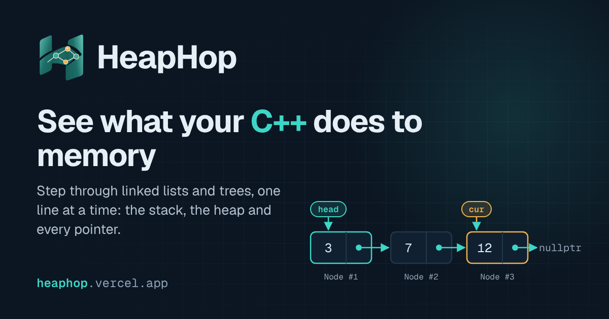

# HeapHop

**See what your C++ does to memory.** HeapHop runs a C++ program one statement at a time
and draws what happens: the stack frames, every node on the heap, and every pointer between
them. Step forward and back, and watch a linked list or a tree being built, rewired and
taken apart.

**Open HeapHop: [heaphop.vercel.app](https://heaphop.vercel.app)**

## Getting started

1. Go to [heaphop.vercel.app](https://heaphop.vercel.app) and choose **Sign up**. An account is
   free and needs your name, email address, university and a password.
2. Open **Learn** for guided lessons, or the **Editor** to run your own program.
3. Press **Run & Visualize**, then step through the program with the arrows or the timeline.

The home page, About, FAQ, Privacy and "What C++ is supported" are open to everyone. Learn
and the Editor need an account.

## What you can do

- **Learn by topic.** 51 guided lessons in nine topics: sorting and Big-O, linked lists,
  doubly and circular lists, stacks, queues, binary search trees, AVL trees, heaps and
  priority queues, and graphs. Each lesson stops at key lines and asks what happens next,
  such as "where will `cur` point after this line?". The answer is checked against the
  program's own run. 25 ready-made programs can be opened and stepped through too.
- **Run your own code.** Write or paste a program in the Editor and visualize it. Programs
  that read input with `cin` take what you type in. Your programs are saved in your browser.
- **See every step explained** in plain words, built from what the program actually did,
  for example "head moves along next from Node #1 to Node #2."
- **Step both ways.** The whole run is recorded first, so going back is as reliable as going
  forward. Use the timeline, auto-play at different speeds, or step over a function call.
- **Inspect anything.** Click a node, a pointer or a line of code to see its history: where
  it was created, what points at it now, and which line changed it.
- **Find mistakes.** Dereferencing a null pointer, using memory after `delete`, deleting
  twice or following a pointer that was never set stops the run at that line with an
  explanation. Nodes nothing points to any more are marked as leaked.
- **Watch Byte.** When you step one line at a time, Byte, HeapHop's robot, acts the line out:
  it drags a pointer to its new node, brings new nodes in and carries deleted ones away.
- **Lists and trees drawn the way they are taught.** Singly, doubly and circular lists sit in
  one row with `head`, `tail` and `cur` on the nodes they point at. Trees are drawn as trees,
  and arrays as rows of cells. Nodes keep their place while a list is rewired.
- **Any screen.** Zoom, pan and full screen on the heap. HeapHop works on phones (with Code
  and Memory tabs), tablets, laptops and large monitors, in a dark or a light theme.

## What C++ it runs

HeapHop runs the part of C++ used in a first data-structures course: structs and classes,
constructors and destructors, pointers and pointers to pointers, references, `new` and
`delete`, arrays, `string`, recursion, loops, `switch`, `cout` and `cin`. Anything outside
that part stops with a message that names the line, so a picture is never drawn from code
HeapHop did not understand.

The full list is in [content/supported-cpp.md](content/supported-cpp.md) and on the site at
[heaphop.vercel.app/supported](https://heaphop.vercel.app/supported).

## Privacy and security

- Your programs run inside your own browser. They are never uploaded, and nobody else can
  see them.
- An account stores your name, email address and university. Your password is stored only
  as a one-way hash.
- You stay signed in with a secure cookie that page scripts cannot read. Two-step sign-in
  with an authenticator app is available in Account settings.
- There is no tracking and no advertising.

The [privacy policy](https://heaphop.vercel.app/privacy) has the details, including how to have
your account deleted. To report a security problem, see [SECURITY.md](SECURITY.md).

## VS Code extension

A VS Code extension shows the same visualization in a panel next to any C++ file. Open a `.cpp`
file and run **HeapHop: Visualize Current File** (Ctrl+Alt+H, or the button at the top right of
the editor); saving the file runs it again. The current step and the line that called it are
highlighted in the editor, code HeapHop cannot run is underlined and listed in the Problems
panel, and there is a box for `cin` input.

Beside everything the website runs, the extension turns on the rest of the C++ a data-structures
course uses — the standard containers (`vector`, `list`, `deque`, `stack`, `queue`,
`priority_queue`, `pair`, `map`, `set`), `<algorithm>`, templates, inheritance and `virtual`
functions, operator overloading, `try`/`catch`, and `<iomanip>` — and draws them the way they
are taught: a `std::list` as its doubly linked nodes, an adjacency list as a graph, a
`priority_queue` as its heap tree. This extended mode is on only in the extension; the website is
unchanged.

The extension lives in [`vscode-extension/`](vscode-extension/).

## The team

HeapHop is the Data Structures semester project of five BS Cyber Security students at
Air University, Islamabad: M. Saim, Yemna Khan, Muhammad Musa, Eeman Athar Malik and
Syeda Nazalia Zehra.

Design ideas came from Python Tutor.

## Questions and feedback

Open an [issue](https://github.com/SAIMKAXI/HeapHop/issues) on this repository. Please do not
include your email address or other personal details in an issue: issues are public.

## License

Copyright © 2026 the HeapHop team. All rights reserved.

HeapHop is **not open source**. The code is public so that it can be read, but no license is
granted to use it. See [LICENSE](LICENSE). To use HeapHop, use the website:
[heaphop.vercel.app](https://heaphop.vercel.app).
