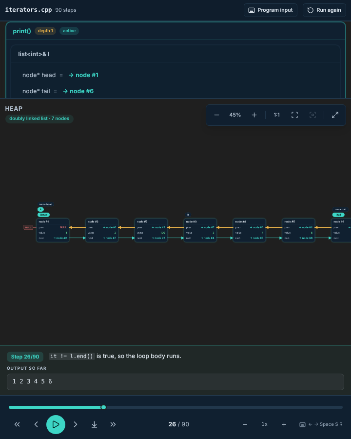
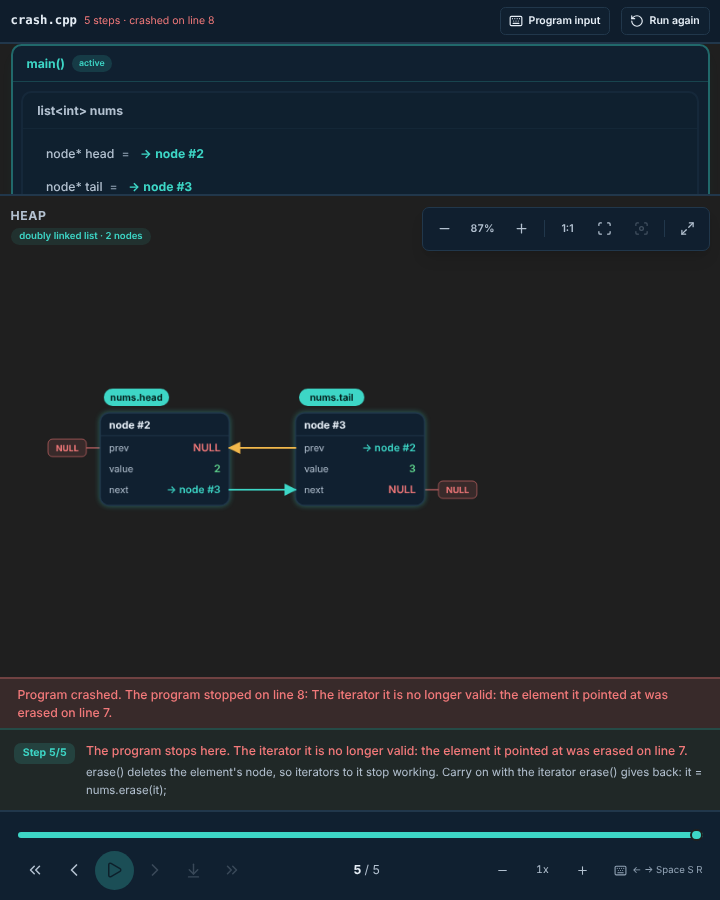

# HeapHop: C++ Memory Visualizer

See what your C++ program does to memory, one statement at a time, right next to your code.
Open a `.cpp` file, press the HeapHop button, and step through the program: the stack frames,
every node on the heap and every pointer between them change as it runs, and the line that is
running is highlighted in your editor.

Made for data-structures courses: linked lists (singly, doubly, circular), stacks and queues,
binary trees and AVL trees, adjacency lists and graphs, and `std::list`.

## How to use it

1. Open a C++ file.
2. Press the **HeapHop** button at the top right of the editor, or press **Ctrl+Alt+H**
   (**Cmd+Alt+H** on a Mac), or run **HeapHop: Visualize Current File** from the Command Palette.
3. The HeapHop panel opens beside your code. Step with **←** and **→**, play it, or drag the timeline.

Every time you save the file, HeapHop runs it again and keeps your place.

## What you get

- **The memory picture.** Stack frames on the left; heap objects and pointer arrows on the
  canvas. Lists are drawn in one row the way they are taught, trees as trees, arrays as rows
  of cells. Zoom, pan and fullscreen.
- **Your editor follows along.** The line of the current step is highlighted, and so is the
  line that called the current function. Put the cursor on a line to mark, on the timeline,
  every step that ran it.
- **Every step explained** in plain words, built from what the program actually did:
  "`it` moves forward along `next` from node #1 to node #2."
- **Click to inspect.** Click a node or a pointer to see who points at it, where it was
  created and which line last changed it, and jump to any of those moments.
- **Mistakes shown honestly.** A null pointer, a use after `delete`, a double `delete`, an
  iterator used after `erase`: the run stops on that line with an explanation, which also
  appears in the Problems panel. Nodes nothing can reach any more are marked as leaked.
- **`cin` works.** Type what the program should read into **Program input**, then run.
- **`std::list` support.** Lists, iterators, `auto` and range-based `for` loops. A
  `std::list` is drawn as what it really is: a doubly linked list of nodes with `prev`
  and `next` pointers. An array of lists (an adjacency list) hangs each list under its
  cell, and is drawn as a graph too.

## Supported C++

HeapHop does not compile your code. It runs the part of C++ that data-structure labs use:

- `struct` and `class`, constructors, destructors, member functions, `this`
- pointers, pointers to pointers, references as parameters, `new` / `delete`, `new[]` / `delete[]`
- arrays (one and two dimensions), recursion, `if` / `switch` / loops, `string`
- `cout`, and `cin` / `getline` with typed-in input
- `std::list` with its iterators, `auto`, and range-based `for`
  (needs `#include <list>` or `#include <bits/stdc++.h>`, as g++ does)

Anything else (for example `vector`, templates, inheritance) stops with a message that names
the line, and that line is underlined in the editor. The full list is on
[heaphop.vercel.app/supported](https://heaphop.vercel.app/supported).

## Settings

| Setting | Default | What it does |
| --- | --- | --- |
| `heaphop.runOnSave` | on | Run again and redraw every time the file is saved |
| `heaphop.highlightLines` | on | Highlight the current step's line (and its caller's line) in the editor |
| `heaphop.followCursor` | on | Mark on the timeline the steps that ran the line your cursor is on |
| `heaphop.showProblems` | on | Underline unsupported code and crash lines, and list them in the Problems panel |

The highlight colours can be changed in your settings with `workbench.colorCustomizations`:
`heaphop.currentLineBackground`, `heaphop.callerLineBackground` and `heaphop.errorLineBackground`.

## Privacy

Your code never leaves your computer. HeapHop runs it inside VS Code, in the panel, with no
network access and no account.

## The website

HeapHop is also a website, with guided lessons on lists and trees:
[heaphop.vercel.app](https://heaphop.vercel.app).

## About

HeapHop is a Data Structures semester project at Air University, Islamabad (BS Cybersecurity),
by M. Saim, Yemna Khan, Muhammad Musa, Eeman Athar Malik and Syeda Nazalia Zehra.

Copyright © 2026 the HeapHop team. All rights reserved. The extension is free to install and
use; its code may not be copied, modified or redistributed. See [LICENSE.txt](LICENSE.txt).
